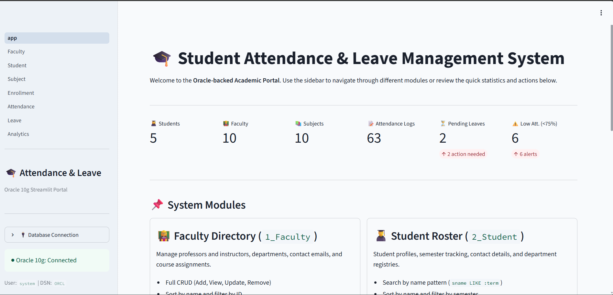
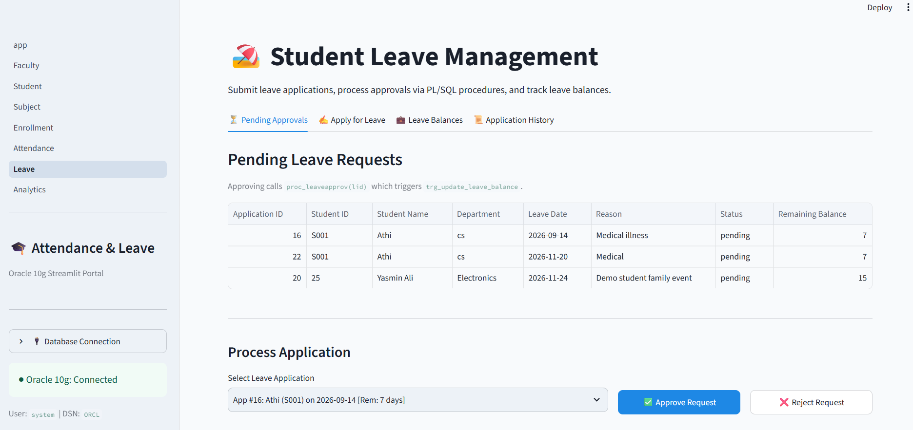
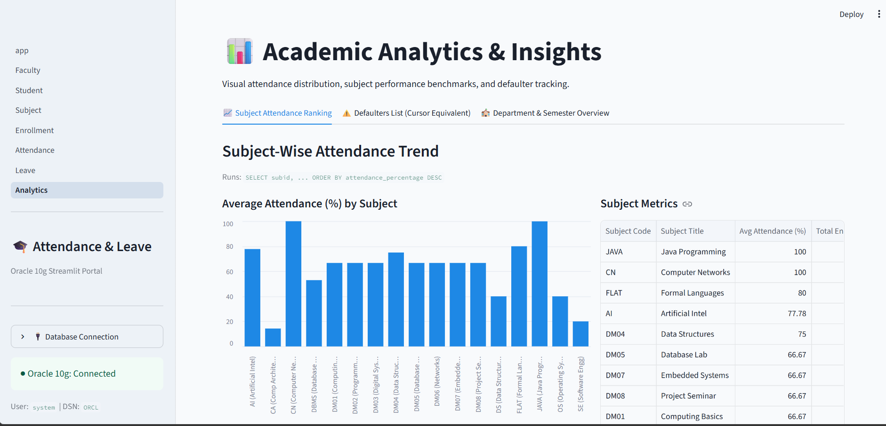

# Student Attendance & Leave Management System

A web-based application developed using **Python, Streamlit, and Oracle Database** to simplify student attendance tracking, leave management, and academic attendance analysis.

## 📌 Problem Statement

Managing student attendance and leave records manually can be time-consuming and prone to errors. Maintaining attendance percentages, processing leave applications, and generating reports also becomes difficult as the number of students increases.

This project aims to provide a centralized system to manage student attendance and leave records efficiently while offering useful insights through analytics.

## ✨ Features

- **Attendance Management:** Maintain and manage student attendance records.
- **Leave Management:** Manage student leave applications and their status.
- **Attendance Analytics:** Analyze attendance records and generate meaningful insights.
- **Dashboard:** View important attendance and leave-related information.
- **Database Management:** Store and retrieve records using Oracle Database.
- **Reports:** Access attendance statistics and analytical summaries.

## 🛠️ Technologies Used

| Technology | Purpose |
|---|---|
| Python | Backend programming |
| Streamlit | User interface and web application |
| Oracle Database | Data storage and management |
| SQL | Database queries and operations |
| Git & GitHub | Version control and project hosting |

## 🏗️ System Architecture

The application follows a simple three-layer architecture:

```text
       USER
         |
         v
  STREAMLIT FRONTEND
      (app.py)
         |
         v
  APPLICATION LOGIC
  (pages / queries.py)
         |
         v
  DATABASE CONNECTIVITY
       (db.py)
         |
         v
    ORACLE DATABASE
   (Tables and SQL)
```

### Architecture Components

1. **Presentation Layer:** Streamlit provides the interactive user interface.
2. **Application Layer:** Python handles application logic, user interactions, and database queries.
3. **Database Layer:** Oracle Database stores student, attendance, and leave-related information.

## 🗄️ Database Design

The system uses Oracle Database for persistent storage.

The database is initialized using `setup_db.sql`.

### Main Database Entities

- **Student:** Stores student-related information.
- **Attendance:** Maintains student attendance records.
- **Leave:** Stores leave application details.
- **Additional entities:** Add other tables according to your actual database implementation.


## 📂 Project Structure

```text
attendance_app/
│
├── .streamlit/
│   └── config.toml
│
├── pages/
│   ├── 6_Leave.py
│   └── 7_Analytics.py
│
├── app.py
├── db.py
├── queries.py
├── setup_db.sql
├── seed_demo_students.sql
├── requirements.txt
└── README.md
```

## ⚙️ Installation and Setup

Follow these steps to run the project locally.

### 1. Clone the Repository

```bash
git clone https://github.com/milimariya/Student-Attendance-Leave-Management-System.git
```

### 2. Navigate to the Project Directory

```bash
cd Student-Attendance-Leave-Management-System
```

### 3. Create a Virtual Environment

```bash
python -m venv venv
```

Activate it on Windows:

```bash
venv\Scripts\activate
```

### 4. Install Dependencies

```bash
pip install -r requirements.txt
```

### 5. Configure Oracle Database

- Ensure Oracle Database is installed and running.
- Configure the database connection credentials securely.

### 6. Run the Application

```bash
streamlit run app.py
```

The application will open in your browser, usually at:

```text
http://localhost:8501
```

## 📸 Screenshots


### Dashboard


### Leave Management


### Analytics



## 🚀 Future Enhancements

- Role-based authentication for students, faculty, and administrators.
- Automated attendance notifications.
- Email notifications for leave application status updates.
- Graphical reports and attendance trend visualization.
- Export attendance and leave reports to PDF or Excel.
- Cloud deployment for remote accessibility.

## 👩‍💻 Developer

**Mili Mariya Varghese**

B.Tech Computer Science and Engineering

GitHub: [@milimariya](https://github.com/milimariya)

---

⭐ If you find this project interesting, consider giving this repository a star!
